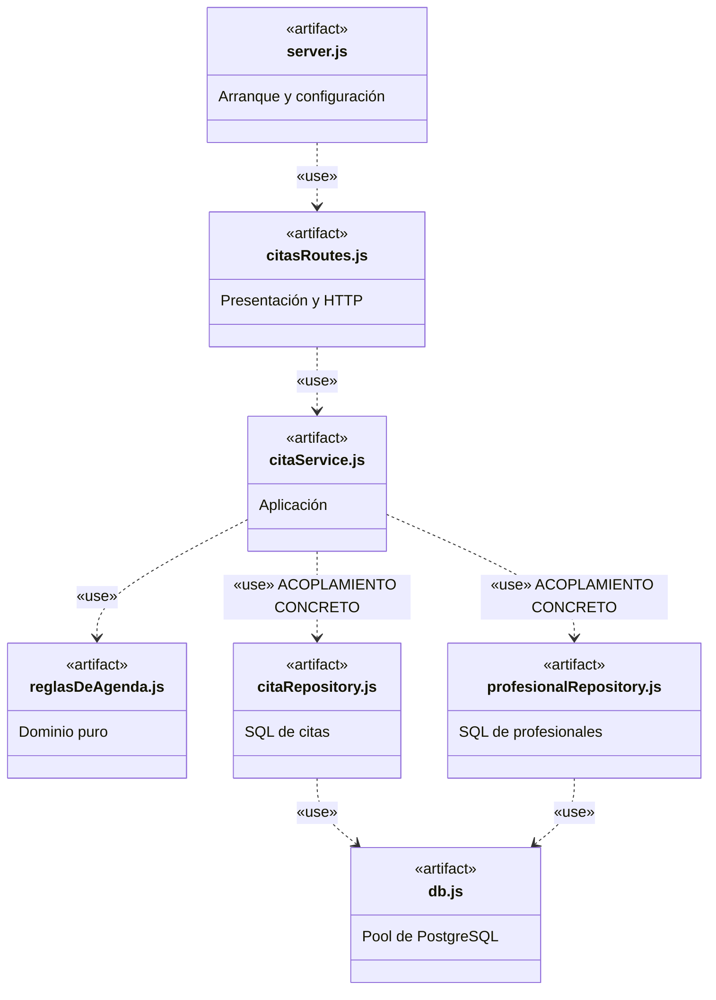
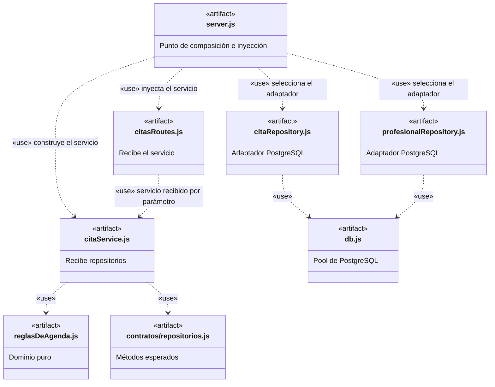

# Semana 9 — DIP e inyección de dependencias en la reserva de citas

Documento de la actividad **«De cliente-servidor a reglas de dependencia»**.
Rama de trabajo: **semana9-dip-di**.

## 1. Pregunta central

**¿Cuántos archivos de negocio habría que cambiar para reemplazar PostgreSQL por un repositorio simulado?**

| Momento | Respuesta | Motivo |
| --- | --- | --- |
| Antes del refactor | **1** (src/aplicacion/citaService.js) | Importaba directamente citaRepository.js y profesionalRepository.js (adaptadores PostgreSQL). |
| Después del refactor | **0** | citaService.js recibe los repositorios por parámetro y solo usa sus operaciones (listarTodas, existeEnHorario, guardar, listarTodos). |

«Cero» aplica a los archivos de **aplicación y dominio**. Para probar sin PostgreSQL solo se prepara un repositorio en memoria en el archivo de pruebas (ver test/citaService.test.js). Si el cambio fuera para toda la aplicación en ejecución, se ajustaría el ensamblaje en server.js.

## 2. Diagrama A — Estado antes del refactor

Las dos dependencias marcadas **ACOPLAMIENTO CONCRETO** son el problema trabajado en esta sesión: la capa de aplicación importaba adaptadores concretos de persistencia. El dominio (reglasDeAgenda.js) ya era independiente y las consultas SQL ya vivían en persistencia/.

## 3. Diagrama B — Diseño después del refactor

Lectura del cambio:

- Las dependencias concretas se **trasladan al punto de composición** (server.js).
- citaService.js conserva únicamente las reglas del dominio y su **contrato propio** (contratos/repositorios.js).
- La relación citasRoutes.js → citaService.js expresa el uso de un servicio **recibido como parámetro** (crearCitasRoutes({ citaService })), no una importación de módulo.
- En JavaScript el contrato se verifica por **presencia de métodos**; como el adaptador no declara formalmente una interfaz, no se dibuja una flecha de realización.

## 4. Reglas de dependencia justificadas

| Relación | Decisión | Justificación (evidencia en el código) |
| --- | --- | --- |
| **Presentación → Aplicación** (permitida) | Se mantiene | citasRoutes.js invoca el caso de uso a través del servicio inyectado: await citaService.reservarCita(req.body). La presentación conoce el caso de uso, su colaborador natural. |
| **Aplicación → repositorios concretos** (eliminada) | Se invierte | Ya no existen require('../persistencia/...') en src/aplicacion/. Los repositorios llegan por parámetro: crearCitaService({ citaRepository, profesionalRepository }). La búsqueda de «persistencia/» dentro de src/aplicacion no devuelve coincidencias. |
| **Punto de composición → infraestructura** (permitida) | Se refuerza | server.js importa citaRepository y profesionalRepository (y a través de ellos db.js), construye el servicio y lo entrega a las rutas: la dependencia concreta queda explícita y localizada en el arranque. |

## 5. Cambios aplicados

| Archivo | Acción | Detalle |
| --- | --- | --- |
| src/aplicacion/contratos/repositorios.js | **Nuevo** | Contrato estructural: exige listarTodas, existeEnHorario, guardar y listarTodos. |
| src/aplicacion/citaService.js | Modificado | Factoría crearCitaService({ citaRepository, profesionalRepository, reloj }); sin importaciones de persistencia. |
| src/presentacion/citasRoutes.js | Modificado | Factoría crearCitasRoutes({ citaService }); mismas rutas y códigos HTTP. |
| server.js | Modificado | Punto de composición: selecciona adaptadores, construye el servicio y lo inyecta en las rutas. |
| test/citaService.test.js | **Nuevo** | Cuatro pruebas unitarias sin Express ni PostgreSQL. |
| test/api-smoke.js | **Nuevo** | Verificación HTTP local (parte D) con fetch de Node.js 18 o superior. |

**Sin modificar** (conservan intactas sus responsabilidades): src/dominio/reglasDeAgenda.js, src/persistencia/citaRepository.js, src/persistencia/profesionalRepository.js, src/persistencia/db.js, public/index.html, db/setup.sql.

## 6. Cuarta prueba del equipo (T4)

Las tres pruebas de referencia (reserva permitida, agenda ocupada, fecha pasada) se conservan sin cambios. La cuarta prueba propia verifica el **contrato de inyección**:

- **Condición inicial:** se intenta ensamblar el servicio con un citaRepository que implementa listarTodas y existeEnHorario pero **le falta guardar()**.
- **Resultado esperado:** un TypeError que nombra el método y el repositorio faltantes, lanzado al **construir** el servicio.
- **Qué se observó al ejecutarla:** el fallo ocurre en el ensamblaje (equivalente al arranque de server.js), **antes** de procesar ninguna petición HTTP y sin tocar la base de datos. Es un escenario distinto de las tres pruebas de referencia porque no valida una regla de negocio, sino la frontera de inyección de dependencias.

Evidencia de ejecución (Node.js v22.11.0):

    $ node --test test/citaService.test.js
    TAP version 13
    # Subtest: reserva permitida
    ok 1 - reserva permitida
    # Subtest: agenda ocupada no genera escritura
    ok 2 - agenda ocupada no genera escritura
    # Subtest: fecha pasada se rechaza sin consultar PostgreSQL
    ok 3 - fecha pasada se rechaza sin consultar PostgreSQL
    # Subtest: T4: contrato rechaza un repositorio incompleto al ensamblar
    ok 4 - T4: contrato rechaza un repositorio incompleto al ensamblar
    1..4
    # tests 4
    # suites 0
    # pass 4
    # fail 0
    # duration_ms 77.9309

Comprobación del desacoplamiento (PowerShell):

    Get-ChildItem -Path ./src/aplicacion -Filter *.js -Recurse |
      Select-String -Pattern 'persistencia/'
    # Resultado: sin coincidencias

    Get-ChildItem -Path ./src/aplicacion, ./src/dominio -Filter *.js -Recurse |
      Select-String -Pattern "require('pg')"
    # Resultado: sin coincidencias

Importaciones resultantes de src/aplicacion/citaService.js:

    const reglas = require('../dominio/reglasDeAgenda');
    const { verificarRepositorios } = require('./contratos/repositorios');

## 7. Compatibilidad HTTP (parte D) — ejecutada contra la base de pruebas

Ejecución real contra la base de pruebas del equipo (Supabase, proyecto **demo-citas**) con el servidor local en el puerto 3000. Comando: node test/api-smoke.js

| Petición | Esperado | Obtenido | Estado |
| --- | --- | --- | --- |
| GET /api/salud | 200 | **200** | OK |
| GET /api/profesionales | 200, lista JSON | **200**, 3 profesionales | OK |
| GET /api/citas | 200, lista JSON | **200**, lista JSON | OK |
| POST /api/citas reserva válida | 201 e identificador | **201** con id | OK |
| POST /api/citas reserva repetida | 409 | **409** | OK |
| POST /api/citas fecha pasada | 400 | **400** | OK |

Salida del script:

    $ node test/api-smoke.js
    API comprobada: GET 200, POST 201, 409 y 400.
    (código de salida: 0)

Estado de la base después de la prueba (consultado por SQL):

    profesionales: 3 filas (Dra. Laura Pérez, Dr. Andrés Rojas, Dra. Camila Torres)
    citas: 5 filas, incluida la creada por la prueba (id 5, paciente «Prueba Semana 9»)
    El POST repetido devolvió 409 y NO generó una segunda fila.

Nota operativa: el proyecto de Supabase del equipo estaba **pausado** (plan gratuito) y hubo que reactivarlo para esta verificación; mientras estaba inactivo su DNS no resolvía y el pooler respondía «tenant not found».

> El script test/api-smoke.js **crea un registro** y debe ejecutarse únicamente sobre una base de datos propia de pruebas. El resultado 409 se comprueba con peticiones secuenciales; no demuestra seguridad ante solicitudes simultáneas (condición de carrera descrita en el punto 8).

## 8. Qué no resuelven DIP ni DI

- **Concurrencia:** la secuencia existeEnHorario() + guardar() no es atómica; dos peticiones simultáneas pueden crear citas duplicadas. La solución posterior es una restricción única (profesional_id, fecha_hora) y traducir el error de duplicado a 409.
- **Seguridad de conexión:** src/persistencia/db.js usa ssl: { rejectUnauthorized: false }; debe revisarse antes de un uso en producción.
